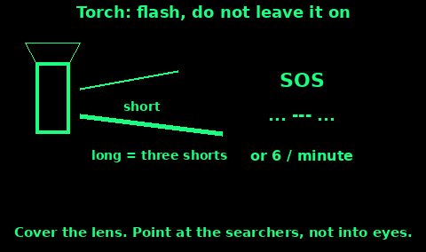
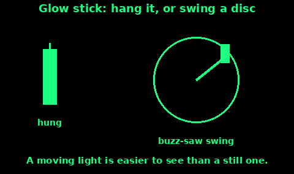
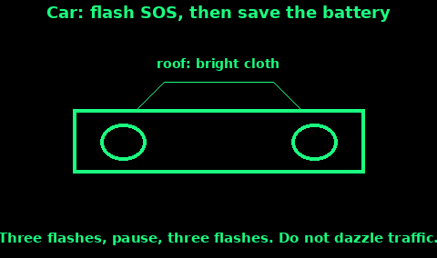

## Torch patterns

A torch is for a pattern, not for leaving on. A steady beam wastes the cells and is easy to ignore.

1. Point it toward the aircraft, the road, or the sound of people.

2. Make the pattern by covering and uncovering the lens if the switch is slow. The light should be fully on or fully off.

3. SOS: three short flashes, three long flashes, three short flashes. A long flash is about three times a short one. Pause. Repeat.

4. On a hill, six flashes in one minute, then a minute of darkness, matches the whistle code. Mountain Rescue England and Wales treats torch and whistle the same.

5. Between efforts, switch off. One spare set of cells lives in an inside pocket. Cold kills a battery that stays in the torch. See Radio power.

If you only have a phone torch, use it the same way, in bursts. A phone screen aimed at a rescuer is a poor torch and a flat battery.

Do not shine into a driver's or a pilot's eyes and hold it there. A flash gets attention. A beam held in the face blinds the person who is trying to reach you.

## Strobe

A strobe is a regular blink, often about once a second. The US Army survival manual notes a strobe at about 60 flashes a minute, and warns that a very fast flash can be mistaken for gunfire. In the UK that is less likely, but a strobe alone also looks like a bike light or a mast.

Use it like this:

1. Switch it on when you hear an aircraft or see lights, not all night.

2. Aim it toward them for a few seconds so the blink is obvious.

3. Then cover it and send SOS, or six slow flashes, so the pattern says "help" and not "cyclist".

4. If you have a choice of colour, red is the distress colour the survival manual names. Any colour is better than none.

5. Shield it from your own eyes. A close strobe ruins your night vision, and you still need to see the ground.

A strobe with a flat battery is a paperweight. Count the hours on the packet, halve them in the cold, and keep the cells warm.

## Glow sticks

A glow stick needs no battery. It is dim next to a torch, and it dies in a few hours, so crack it when you need it.

1. Bend it until the inner glass breaks. Shake it. If it is still dark, it is spent or frozen. Warm it inside your jacket and try again.

2. Hang one as high as you can, with open sky behind it. Tie it to a pole, a branch, or the aerial of a car.

3. Three sticks in a triangle, a few metres apart, read as a deliberate mark. One stick reads as litter unless it is moving.

Buzz-saw, for when you hear an aircraft:

1. Hold the stick, or tie it to a short cord.

2. Swing it in a flat circle beside you, fast enough that it looks like a disc of light. Keep the circle away from your face and from anyone else.

3. Do this in bursts of half a minute. Then stop and listen. A moving light is easier to see than a still one.

4. Do not throw it. You need it in your hand for the next pass.

Do not bite a stick, burn it, or cut it open. The liquid irritates skin and eyes. If it splits, wipe it off and wash with water. Keep them away from children who might chew them.

## Car headlights

Headlights are a big lamp with a short life. The battery also starts the engine. Treat it as a signal, then protect it.

1. If the car runs, idle it only while you signal, and only if the exhaust is in the open air. Do not run an engine in a garage, a snow pit, or a closed space. Carbon monoxide kills. See Power.

2. Flash SOS: three short, three long, three short. Use the main beam switch or a hand over one lamp if you must. Pause. Repeat.

3. If you cannot time SOS, three flashes, a pause, three flashes.

4. By day, headlights do little. Put a bright cloth on the aerial or the roof, and use the horn in threes. Open the bonnet only if that is your group's sign for "we need help", and you are off the carriageway.

5. Aim across open ground or up at an aircraft. Do not hold main beam into oncoming traffic.

6. Then switch off. Start the engine later, if it is safe, to put some charge back. A flat battery and a dark lay-by is worse than a short flash.

Hazard lights are a slow blink other drivers expect from a breakdown. Add the horn pattern so it is clearly a call for help. A note under the wiper with the time, the number of people, and the direction you walked is on the Trail markers topic.
