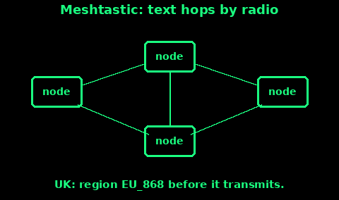

## Meshtastic and LoRa at 868 MHz

Meshtastic is a way to send short text between small radios. The radio link is LoRa, which is built for low power and long range, not for voice. Each radio is a node. A node that hears a message can pass it on, so a string of them covers more ground than one pair. If there is no other node in range, the message waits on your set.

There is no monthly fee and no phone network in the path. There is also no one listening unless your own people are.

In the UK, Meshtastic's region table says EU_868 (and EU_433 is also listed, under the same Ofcom interface document). Use EU_868 for the 868 MHz radios this card is about. Do this before you let the node transmit. An unset region, in current Meshtastic, shows a warning and does not send. A node left on the United States region will transmit on American frequencies. Those are not yours to use here.

EU_868, from Meshtastic's own region table:

- 869.40 to 869.65 MHz.

- The usual LongFast preset sits on 869.525 MHz.

- Duty cycle 10 percent. In plain terms, the transmitter must spend most of each hour silent.

- Power cap in the firmware 27 dBm, which is 500 milliwatts ERP.

Ofcom IR2030/1/19 is the UK rule for that slice: 869.40 to 869.65 MHz, 500 milliwatts e.r.p., and either proper interference-mitigation or a duty cycle of 10 percent or less. Stay inside the preset. Do not add an amplifier. Do not type in a frequency you found on an American forum.

EU_433 is a different band with a much lower power cap in the Meshtastic table. If your hardware is a 433 MHz radio, use that region, not EU_868. The antenna and the radio are built for one band. A mismatch is a deaf node.

Licensed amateurs can use other Meshtastic regions that sit inside the amateur bands. Only with a licence, and only after you have checked the UK band plan. Everyone else stays on EU_868.

## Setting a group up

1. Put fresh power in every node. A mesh of one working radio is a notepad.

2. Set the region to EU_868 on each node. Check the screen or the app says EU_868, not UNSET and not US.

3. Set the same channel name and the same key on every node in the group. Different keys mean you will not see each other's messages. The default public channel is readable by any other Meshtastic user in range. For a family, set a private channel and keep the key written on paper with the wallet card.

4. Name each node after the person who carries it. "Nia" is more useful than a random number when you are tired.

5. Send a test from the kitchen to the garden, then from the house to the end of the street. Learn what your actual range is, the same way as with PMR446. Hills block 868 MHz. A node in a window or a loft beats a node in a coat pocket. Height and a clear view matter more than the slogan on the box.

6. Agree when you will look. A message does not ring the way a phone does unless you have set the alert and you are watching. A check-in window from the Comms plan still applies.

7. Keep the phone app, if you use one, as the keyboard. The radio does the long link. Bluetooth from the phone to your own node is not the mesh. The mesh is node to node.

The duty cycle means you cannot chatter. Type the message, send it, and stop. A node that talks too often is also a node that breaks the exemption.

## What it will not do

1. It will not call 999. There is no coastguard at the other end unless a person you know is there and decides to phone.

2. It will not carry a voice call, a picture of any size, or a long letter. Short text. Positions, if you turn that on, in few words.

3. It will not cross a ridge because you want it to. No node on the far side means no message on the far side. A relay node lives on the ridge, in the dry, with power, or it does not live there.

4. It will not be private on the default channel. Assume a neighbour with the same hobby can read the public channel. Use your own key for family traffic. Even then, do not put a secret you cannot bear to lose onto a radio.

5. It will not replace the phone, the PMR446 net, or the whistle. It is the contingency line in PACE, after you have tested it. An untested gadget in the bottom of a bag is not a plan.

6. It will not get louder if you fit a huge aerial and turn the power up past the preset. That is how you leave the licence exemption. The preset is the legal one. Leave it.

If the mesh is quiet at a check-in, do the next line of the plan. Phone, note at the rally point, then 999 if someone is actually in danger. Do not stand on a hill rebooting a node while the daylight goes.
