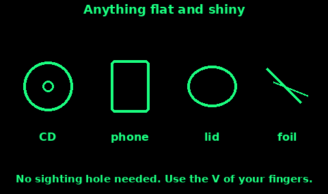

## Signal Mirror

A sun flash is the longest-range daylight signal most people can make. The US Army survival manual says pilots have reported mirror flashes at up to about 160 km in ideal conditions, and that haze, fog, and mirage hide them. Get as high as you can. If you cannot see the aircraft, flash toward the sound.

A purpose-made mirror has a sighting hole. Follow the instructions on its back if you have one. Most people do not. The finger method below needs no hole.

1. Face the sun. Hold the mirror near your face, shiny side out, and tilt it until you catch a bright spot.

2. Hold the other hand out at arm's length. Make a V with two fingers.

3. Put the target, the aircraft or the boat or the vehicle, in the gap of the V.

4. Tilt the mirror until the bright spot sits on your fingers, in the V.

5. Rock the mirror slowly so the spot jumps off your fingers and across the target, then back. A slow, deliberate flash. Do it in threes, or as SOS.

6. Sweep the horizon even when you see nothing. A distant aircraft is a speck.

Once a pilot has clearly seen you, stop holding the beam in the cockpit. A mirror in the eyes blinds the person flying. A few flashes are a signal. A stuck beam is a hazard.

Practise on a tree before you need it. Do not practise on aircraft.

## Improvised mirrors

You do not need a glass mirror. You need a flat shiny face.

Things that work:

- A CD or DVD. The shiny side, not the label.
- A phone or tablet with the screen off and as dark as you can make it. It is a poor mirror, and it spends battery if the screen is lit. Use it, then lock it.
- A tin lid, a canteen cup, or a belt buckle, polished on a cloth. The survival manual names a cup and a buckle for this.
- Foil from a ration pack, smoothed on a card so it stays flat. Creased foil scatters the light.
- A piece of glass or a wing mirror from a vehicle, if you can hold it safely.

Wipe it. A film of grease or grit kills the flash. Keep the shiny side against your body or in a pocket when you are not signalling, so you do not flash the hillside by accident.

If the only shiny thing is curved, it still throws a glint, but you cannot aim it. Use it to sweep, and back it up with a fire, a cloth, or a ground symbol.

## Aiming without a sighting hole

The V method is the way to aim when there is no hole in the mirror. Here it is as a drill you can do with cold hands.

1. Sun behind the mirror, target in front of you. If the sun is in your face, a mirror cannot help. Use smoke or a cloth instead.

2. One hand holds the mirror at your cheek, just below your eye, so you can look past it.

3. The other arm is straight. Two fingers make a narrow V. The target sits in the V.

4. Watch the fingers, not the mirror. Tilt the mirror until a hard white spot appears on the fingers.

5. That spot is the beam. Move the V onto the target, keeping the spot on the fingers, or rock the mirror so the spot flicks from the fingers onto the target.

6. A second method from the same manual: catch the spot on your palm, hold the palm just under the aim point, then lift the beam off the palm and onto the target. Use this if a V is hard to hold.

7. Flash in threes. Pause. Look and listen.

If you have no free hand, prop the mirror and tilt it with a thumb. A flash into empty sky is still worth doing when you hear an engine.

Glass mirrors break. Tape the back, or use the CD, so a crack does not become a cut.
