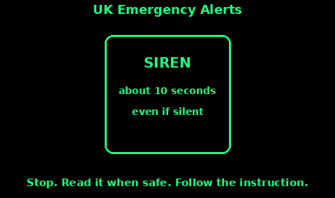

## Broadcast Radio for News

A battery radio or a wind-up radio is the news path when the internet and the mast are not there. FM is the one to set up first. AM (medium wave) still carries some services and travels further at night, with more noise.

From the BBC's current FM and AM list:

- BBC Radio 4 on FM: 92.5 to 96.1 MHz, or 103.5 to 104.9 MHz, with local variations in Scotland, Wales, and Northern Ireland. Use the BBC transmitter checker for the exact channel at your house.

- BBC Radio 5 Live on medium wave: 693 and 909 kHz.

- Local BBC stations are on FM. The frequency is different for each transmitter. Berkshire is not Bristol. Write yours down.

That list does not show Radio 4 on long wave. Do not build a plan around 198 kHz.

DAB carries local and national stations where there is a multiplex. A steel frame, a basement, or a dead multiplex means DAB vanishes while FM is still there. Know the FM number anyway.

Medium wave often reaches further after dark, and it picks up more interference. If FM is empty, try 693 and 909 for 5 Live, then go back to FM in the daylight.

Write the frequencies on the wallet card and on a label stuck to the radio. Tuning from memory, in the dark, is how you miss the bulletin.

## BBC local radio

Local radio is where a regional emergency is actually explained: which roads, which rivers, which shelter.

1. Before you need it, find your station. The BBC reception guide lists every local FM frequency by transmitter. Pick the transmitter nearest your house and nearest your far rally point. They may differ.

2. Tune it, and store it as a preset if the radio has presets. Name the preset "local", not "1", so someone else can find it.

3. Listen on the hour. That is when the news is most likely to be a full bulletin rather than music.

4. If you are away from home, retune. A preset from your kitchen may be a hiss in the next county. Scan FM, or use the frequency you wrote for that area.

5. Nations stations sit in between: Radio Scotland, Radio Wales, Radio Ulster, Radio Cymru, and the others on the same BBC list. If you cannot find the local station, the nation station is the next try.

A wind-up or battery set on the table, tuned and proved, is worth more than a smart speaker that needs the wifi.

## UK Emergency Alerts

Emergency Alerts is the UK government system for a warning when lives are in danger. Flooding, fire, a storm, and other threats to life. Only the emergency services and the government bodies that deal with emergencies can send one.

What you will notice:

1. A loud siren-like sound for about ten seconds, even if the phone is on silent. It may vibrate, and it may read the message out.

2. A message on the screen with what is happening and what to do. It can include a phone number or a link. You can check a current or past alert at gov.uk/alerts.

3. You get it because your phone is in the area, not because of your home address. Location services do not need to be on. The government does not need your number. The mast broadcasts it to compatible phones in range.

4. It works on 4G and 5G. Gov.uk says a phone that is off, on 2G or 3G only, wifi-only, or not compatible will not get it. Airplane mode may block it. Keep software updated. iPhones need a recent iOS; Android 11 or later is the stated line, and some older Android phones still can.

What you do:

1. Stop, when it is safe, and follow the instruction in the message.

2. If you are driving or riding, do not read it. Find a safe legal place to stop. If you cannot, and nobody else can read it, listen to live radio. Using a handheld phone while driving is illegal.

3. It is free. You do not install an app and you do not reply. The message is one-way.

4. The service will not email you and will not ask for personal details. An email that claims to be an Emergency Alert is a scam. Check gov.uk/alerts instead.

5. Alerts do not replace the radio. If your phone cannot receive them, local radio and the emergency services' other warnings are how you hear.

You can switch alerts off in the phone's settings. Gov.uk recommends leaving them on. A phone in a drawer cannot warn you. A radio on the hour still can.

## A wind-up radio and a listening schedule

When the cells are flat, the wind-up set is the news.

1. Prove it on a normal day. Tune your local FM station. Wind the handle until it will play, and see how long a full wind actually lasts on your set. Write that time on the case. The packet's figure is not your figure.

2. Do not wind past the stop. If the handle fights you, stop.

3. For a bulletin, wind, listen from a minute before the hour to a few minutes after, then switch off. News on the hour is the habit to keep.

4. A listening schedule the whole household shares: for example 07:00, 13:00, and 18:00, plus any time an alert has told you to listen. Between those times the radio is off and the room is quieter, which also saves the charge.

5. If you have both a battery set and a wind-up, use the battery set for the scheduled bulletin and keep the wind-up as the reserve. Or the other way round. Write which is which.

6. Aerial up, and the set near a window if FM is weak. The Antennas topic is there if a few metres of wire would help a stubborn station.

7. Someone writes the useful sentence down. "Bridge closed, shelter at the school, boil water." A bulletin you cannot remember is a bulletin you did not hear.

The Emergency plan topic has the grab-bag radio. This card is how you use it once you are sitting still.
