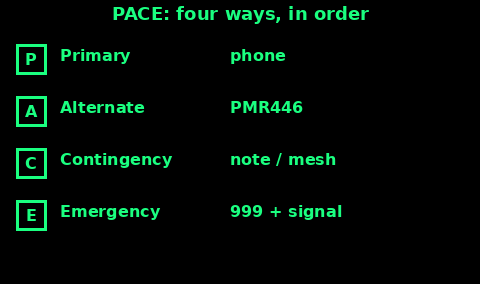
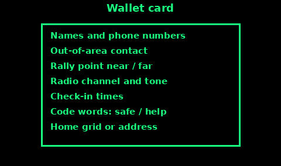

## Group Signal Plan

Agree this before anyone walks out of sight. A plan made after you are split is a wish.

1. The place you will wait if you are separated. One spot near the start, one spot further out. Both are on the rally card below.

2. The sound that means "I am here" (one short whistle) and the sound that means "come to me" (two shorts). Six in a minute and SOS stay reserved for real distress. The Sound topic has the detail.

3. The radio channel, the tone, and the next time you will both have the radio on.

4. Who carries the whistle, the torch, and the spare cells. Not all of them in the same rucksack.

5. The time you are due back, and the person at home who knows it. Mountain Rescue England and Wales asks for start, finish, estimated return, and a contact, left somewhere reliable.

Tell every adult the same five points. Ask one of them to say it back. If they cannot, you do not have a plan yet.

## A family PACE plan

PACE is four methods, in order. When one fails, you move to the next. You write them down. You do not invent them on the day.

Primary. The thing you will try first. For most households that is the mobile phone: a call or a text to one named person. Save the message in drafts if the network is jammed, and keep trying. Texts sometimes get through when a call does not.

Alternate. The second system, already set up. PMR446 on the channel and tone from the channel plan. Or a second phone on a different network, if you have one.

Contingency. The method that still works when the radio and the phone do not. A note at the rally point. A Meshtastic message if you have practised it (Mesh text). A whistle and a torch if you are within a valley of each other. An amateur contact, if someone in the family is licensed.

Emergency. 999 or 112, and the signals in this guide: six blasts, a mirror, a ground V, a fire you can control. This is for danger, not for "I am late".

Write one line each:

- P: phone, this number.

- A: PMR446 channel and tone.

- C: note at the rally point, or the mesh channel.

- E: 999, and the distress signal you will actually use.

Put the same four lines in every grab bag. The Emergency plan topic has the rest of the household plan. This card is only the communications half.

If the primary works, you do not owe anyone a radio check. PACE is the order you fall back through, not four things you do at once.

## Check-in windows and rally points

A check-in window is a few minutes when everyone who can will try the same method. Outside that window, silence is normal, not a crisis.

Pick windows you can remember when you are tired. Examples that work for a lot of families:

- On the hour, for five minutes, while a trip is underway.

- Twice a day at home in a long outage: 08:00 and 20:00.

1. In the window, switch the radio on, or try the phone, or read the note.

2. Say the safe word from the Codes topic, your name, and where you are. Then "out" if nothing is wrong.

3. If you get no answer, try once more at the end of the window. Then switch off. Save the battery for the next window.

4. Two missed windows in a row, and no note, starts the next line of PACE. One missed window is a late person. Two is a reason to move.

Rally points:

1. Near. Just outside the house, for a fire. A lamp post or a neighbour's gate you can name. Everyone can walk there in a minute.

2. Far. Outside the area, for when you cannot go home. A friend's house, a school gate, a station. Agree the route in daylight.

3. On the hill. The last obvious point: the car, the stile, the bothy. Leave the note there.

If you leave a rally point, leave a note with the time and the next place. An empty gate with no note looks the same as "still coming" and "gone elsewhere".

## Out-of-area contact

Local phone lines and local mobiles jam when everyone calls at once. A number outside the area often still works. Pick one person who lives well away, who agrees to the job.

Their job:

1. Stay available at the check-in times, or leave a phone that can take a text.

2. Write down who called, when, where they are, and that they are safe or not.

3. Tell the others when they check in. They are the noticeboard. They do not have to drive to you.

4. If someone is missing after two windows, they call 999 with the route plan you left them. They need that plan on paper, in advance.

Your job:

1. Everyone in the household has the number on paper, not only in a phone.

2. You text or call them first, even before you call each other, if the local network is failing. "Safe, at the far rally, Nia" is enough.

3. You tell them when the plan changes, on an ordinary day, so they are not working from last year's route.

Choose someone who will answer, not someone who is on the same street. Two households on one flooded exchange are not an out-of-area contact.

## Wallet card

A card in a wallet survives a flat phone. Write small. Laminate it or cover it with tape. One for each person, including a child's pocket.

On the card:

1. Your name, and a phone number that is not your own mobile.

2. The out-of-area contact: name and number.

3. Near rally and far rally, in words a stranger could use. "Gate of 14 Hill Street" beats "the usual place".

4. Radio: "PMR channel 4, tone 8, backup channel 7". Or "no radio".

5. Check-in times.

6. The safe word and the help word. The duress word can live here too if the card stays in your pocket and not on the fridge. Know the trade: a lost wallet teaches the word.

7. Home address or a grid reference, and anyone who needs medicine named in a way a paramedic can use.

8. 999 and 112, so a shocked person is not hunting for them.

Update the card when the numbers change. An old number is worse than a blank, because people trust it. Date the card in a corner so you can see which is current.

The Emergency plan grab-bag list already asks for a written plan and phone numbers. This card is that list, cut down to what you can carry every day.
