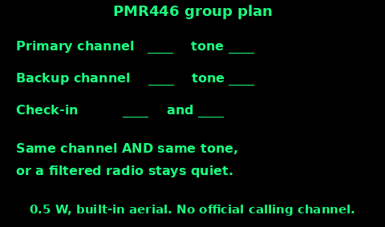
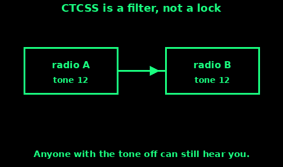

## PMR446 Walkie-Talkies

PMR446 is the licence-free handheld band in the UK and much of Europe. Ofcom's conditions:

- Handheld only. No base station, no repeater, no aerial on the roof.

- The aerial is the one built into the radio. Do not fit a socket, a mag-mount, or a "longer whip" and expect the exemption to survive. Ofcom says a modification has to stay inside the interface rules, and the harmonised rule is an integral aerial.

- 0.5 watt ERP at most. About half a watt out of the aerial.

- 446.0 to 446.2 MHz. Analogue uses 12.5 kHz channels. Digital may use 12.5 or 6.25 kHz. A digital set and an analogue set do not talk to each other.

- Shared. You have no right to a clear channel. If someone else is on it, move.

- Not for use in the air.

- A set that can latch the transmit button, or that has no button and uses voice activation, must stop itself after 180 seconds.

There is no official calling channel. Channel 1 is simply the first one in the list, so it is often busy. Agree your own.

Analogue channel centres, channel 1 at 446.00625 MHz, then 12.5 kHz (0.0125 MHz) higher each time:

1 446.00625. 2 446.01875. 3 446.03125. 4 446.04375.

5 446.05625. 6 446.06875. 7 446.08125. 8 446.09375.

9 446.10625. 10 446.11875. 11 446.13125. 12 446.14375.

13 446.15625. 14 446.16875. 15 446.18125. 16 446.19375.

Older sets stop at channel 8. If one radio in the group is an 8-channel set, pick the plan from channels 1 to 8.

American FRS and GMRS radios are not PMR446. Different frequencies, often higher power. Do not use them here.

## A channel plan

Write this down before the walk, the event, or the power cut. Every set in the group gets the same numbers.

1. Primary channel and tone. This is where you check in.

2. Backup channel and tone. You move here if the primary is a wall of other people. Say the move once on the primary: "Moving to channel 7". Then go.

3. Who listens. One radio on, on the primary, in a pocket with the aerial up. The others off, to save cells. At the check-in minute, everyone switches on.

4. Names. "Sam, this is Nia" is enough. There is no call sign.

5. A missed check-in. If two check-ins pass with no answer, start the backup you agreed: phone, then the rally point, then 999 if you believe they are in trouble. Do not spend an hour calling on a dead channel in a valley.

6. Emergency speech. If it is real, plain English: "This is Nia, at the footbridge, Sam is hurt, we need help." Then try 999. Nobody official is sitting on your PMR channel waiting for a Mayday.

Test the pair in the car park, both ways, before you need them. A channel plan you have not tried is a guess.

## CTCSS codes

CTCSS is a quiet tone sent under your voice. You cannot hear it. The other radio listens for that tone before it opens the speaker. Ofcom describes these tones, and the digital equivalent, as a way to ignore transmissions that are not for you.

What it does:

1. Both radios set to the same channel and the same tone: you hear each other, and you are spared a lot of other traffic.

2. Your tone on, their tone off: they may hear you, you will not hear them.

3. Different tones: neither opens for the other, even on the same channel. You can spend an hour calling a person who is two fields away.

What it does not do:

- It does not make the channel yours.

- It does not hide the words. Anyone with the tone switched off, or with the squelch open, can listen. Do not say secrets on PMR446.

The number on the screen, often 0 to 38, is a label for a tone. 0 or OFF means no filter. Many brands share one list, and some do not. The only check that counts is both radios in the same room: you talk, they hear, then you swap. Write the number that worked, not the number you hoped.

If the hillside is quiet, OFF is simpler and you will not miss a call from a set that has the wrong tone. If the channel is full of a building site, pick a tone together and keep it.

## Range, and what the box means

446 MHz is close to line of sight. A hill between you is a wall. Wet trees, a town, and a car body all shorten the path. Height helps more than shouting.

Ofcom describes PMR446 as short range: the sort of distance that covers a site, a building, or a small area of open ground. The figure printed on the box, often several kilometres and sometimes more, is a best case. It is measured, if it is measured, with both aerials up, nothing in the way, and a quiet channel. It is not a promise for a wood or a valley.

What actually changes the range:

1. Both aerials vertical, and not gripped in a fist. The aerial is the short stub on the top. Your hand around it is a loss.

2. Both people still, and as high as is safe. A ridge to a ridge works. A valley to the next valley often does not.

3. Slow speech, and one transmission at a time.

4. Weather and leaves. A winter hillside with no leaves goes further than a July wood. Do not bet a safety plan on the winter figure.

Find out for your own pair. Walk a route you know, check in at set points, and write the furthest place you still understood the words. That number, for that ground, is your range. The number on the box is advertising.

If you need more than that, a licence is the honest answer: amateur radio, or a proper business radio, with the aerial and the power that licence allows. A modified PMR446 with an extra aerial is the illegal answer. Do not do it.
