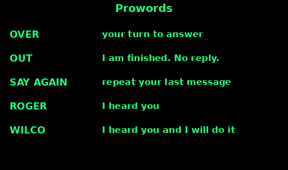

## Making a call

A call has three parts: who you want, who you are, what you want. Then you stop.

On a marine VHF, or any radio with a call sign:

1. Listen. If someone else is talking, wait.

2. Say their name or call sign.

3. Say "this is", then your name or call sign.

4. On a first call, say both names twice if the channel is noisy.

5. Say the message in one or two sentences.

6. Say "over" if you want an answer. Say "out" if you do not.

Example, a group on PMR446 with no official call signs: "Sam, this is Nia. We are at the bridge. Over."

Example, a ship: "Solent Coastguard, Solent Coastguard, this is yacht Kestrel, Kestrel, call sign MABC. Over."

A UK amateur call sign is the one on your Ofcom licence. Use it at the start and the end of a contact. Do not transmit on the amateur bands without that licence.

Spell a name that is being lost with the phonetic alphabet on the Codes topic. Speak a little slower than normal conversation. Shouting distorts the microphone.

## Prowords

Prowords are the short words that run a voice contact. The MCA's small-boat guidance says to speak clearly using prowords, to listen first, to be brief, to identify yourself, and to wait for a reply before you send again.

OVER. I have finished this sentence and I am listening. Your turn.

OUT. I have finished and I do not expect an answer. The contact is closed.

Do not say "over and out". One of them is "please answer". The other is "do not answer". Pick one.

SAY AGAIN. Repeat your last message. Use this instead of the word "repeat". On some radios "repeat" has a different job.

ROGER. I heard your last message. All of it. It does not mean yes, and it does not mean I will do it.

WILCO. I heard you, and I will do what you asked. It already includes ROGER. You do not need both.

Say YES or NO when you are answering a question. "Roger" to "are you hurt?" is how people get the wrong answer.

If you heard only part of it: "Say again all after the bridge."

## Mayday and Pan-Pan

MAYDAY is for grave and imminent danger, when you need immediate help. PAN-PAN is urgent, when a person or a boat is in danger but not in that immediate way: a breakdown you cannot handle, a medical problem that is serious but not a collapse. The RYA describes Pan-Pan that way. Both are spoken on VHF channel 16, on high power, after you have listened.

If the radio has DSC, the MCA says: for Mayday, press and hold the distress button until the alert goes. Wait for an acknowledgement or about 15 seconds, then the voice call. For Pan-Pan, do not press the red distress button. Send an urgency DSC call if you have one, then the voice call.

Mayday, spoken slowly:

1. MAYDAY, MAYDAY, MAYDAY.

2. This is (your vessel's name), three times.

3. Your call sign or MMSI.

4. MAYDAY again, then the name, the call sign, and the MMSI once more.

5. Position. Latitude and longitude if you have them, or a bearing and distance from a named point.

6. What is wrong. Fire, sinking, man overboard, medical.

7. The help you need.

8. How many people are on board.

9. Any other fact that changes the rescue. "Abandoning to the liferaft." Then OVER.

Release the button and listen. If nobody answers, check you are on channel 16, high power, and send it again. Speak more slowly the second time.

Pan-Pan uses the same information. Start with PAN-PAN, PAN-PAN, PAN-PAN, then "all stations" three times, or the coastguard's name, then "this is" and your name three times. The MCA script then moves you to a working channel for the detail. Say what you are going to do, not only what you want. "Engine failed, anchoring, two people on board."

If you are on a hillside with a marine handheld and no other radio, a real Mayday is still a real Mayday. The licence point is on the next cards. A life comes before the paperwork. Say where you are in words a coastguard can plot.

## Securite

Securite (say "say-cure-ee-tay") is the safety signal. It is for a warning that matters to navigation or safety, not for your own emergency. A drifting container, a buoy off station, a sudden weather warning you have been asked to pass.

The international voice pattern, as published for mariners, is:

1. SECURITE, SECURITE, SECURITE.

2. All stations, three times. Or one named station.

3. This is (your name), three times, plus the call sign.

4. The warning, short and concrete. Then OUT, or OVER if you need them to answer.

On a UK small boat the MCA route is simpler if you are calling the coastguard with safety information: use a DSC individual call with safety priority if the radio has it, wait, and speak on the working channel they give you. If the radio cannot do that, make a voice call on channel 16 and move off it as soon as they tell you to.

Do not use Securite to chat about the weather. Channel 16 is for distress, urgency, safety, and calling. The chat happens on a working channel.

## Marine VHF Channel 16

Channel 16 is 156.8 MHz. It is the distress, urgency, safety, and calling channel. HM Coastguard keeps a watch on it. You call on 16, you pass a Mayday on 16, and you leave 16 as soon as a normal conversation has a working channel to go to.

A marine VHF used as a marine radio needs an Ofcom ship radio licence, or a ship portable licence, and the operator needs at least the Short Range Certificate. The set belongs on a vessel or its tender, within what that licence allows, including UK inland waters where the licence says so. It is not a hill radio.

The exception is a real emergency. If someone is in danger and this radio is the way to reach the coastguard, use it. Say Mayday, say where you are, and do not dress it up.

DSC: lift the cover and hold the red distress button for about five seconds. If a GPS is connected, the alert carries your position. Then do the voice Mayday as well. An alert with no voice is harder to act on.

After the emergency, write down what you sent and who answered. The coastguard will ask again.

## Relaying for someone else

You hear a Mayday, and the coastguard does not answer. The MCA says to use any means you have to relay that distress to a coast station.

Before you relay:

1. Stop your own chatter. Listen on channel 16.

2. Write down, or memorise: their name, their position, what is wrong, how many people, and what they asked for.

3. Wait a short time. The MCA's figure for "no DSC acknowledgement" is about five minutes before a ship that can help acknowledges by voice. If you are close and they are clearly not being answered, do not wait out of politeness while a boat sinks. Use your judgement, then transmit.

The relay, spoken on channel 16:

1. MAYDAY RELAY, MAYDAY RELAY, MAYDAY RELAY.

2. All stations, three times. Or the name of the coastguard.

3. This is (your name), three times, and your call sign.

4. MAYDAY, then the name of the vessel in trouble.

5. Their position, the nature of the distress, the help they need, the number of people, and that you are relaying because you heard them and they were not answered.

6. OVER.

If you can help, say so after the relay is acknowledged: where you are, what you can do, and when you might arrive. Do not rush off and leave channel 16 until the coastguard has what they need.

On a hill, with a phone, relaying means you call 999 and pass on what you heard: six whistle blasts from such-and-such a ridge, or a Mayday you caught on a radio. You are a witness. Give your own position as well.

## Radio discipline

A radio that is talking is a radio that is eating its battery, and blocking the channel for everyone else.

1. Listen before you press the button. If the channel is busy, wait.

2. Plan the sentence, then press, then speak, then release. Dead air while you think is still a transmission.

3. Keep it short. Names, place, what you need. The story can wait until you are face to face.

4. Use the lowest power that reaches. On a marine set, low power for a nearby boat, high power for distress and for the coastguard. PMR446 is already limited to 0.5 watt.

5. One person transmits. The others listen. Two sets transmitting at once means nobody is heard.

6. Agree check-in times and switch the radio off between them. A listening watch by one set is enough. See Comms plan.

7. PMR446 sets must stop transmitting after 180 seconds even if the button is held or the voice-activation is stuck. Do not tape a button down. If a set is hot or the light stays on transmit, switch it off.

8. In the cold, keep spare cells in a pocket. A cold pack dies early and recovers a little when it warms. See Radio power.

9. Do not read out addresses, card numbers, or a full medical history on an open channel. PMR446 and marine calling channels are shared. Anyone on that channel can hear you.

## Amateur Radio Notes

Anyone may listen to the amateur bands. To transmit you need an Ofcom amateur licence.

The usual route is Foundation, then Intermediate, then Full. The RSGB runs the exams. The paper and the rules have changed before, so check the RSGB before you book or quote a pass mark.

Useful map, for listening and for after you are licensed:

- 2 metres is 144 to 146 MHz. A common FM calling frequency is 145.500 MHz. Confirm it on the current RSGB band plan before you call on it.

- 70 centimetres is 430 to 440 MHz.

- HF bands can reach other countries because the signal can bounce off the ionosphere. VHF and UHF are much more line-of-sight.

Local clubs, and volunteer groups such as RAYNET, are how licensed people actually get practice, and how they help in civil emergencies. Join before you need them.

An amateur handheld is not a licence-free walkie-talkie. The PMR446 rules do not apply to it, and an amateur radio is not legal on PMR446 frequencies unless it also meets the PMR446 exemption, which a modified set with a changeable aerial generally does not. Ofcom is plain that a PMR446 radio stops being licence-exempt if you modify it outside the rules.

Get the licence in ordinary time. The exam is the easy part. The hard part is knowing the local people who will answer.
