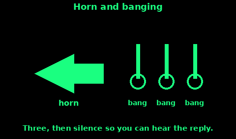

## Whistle and Torch Signals

Carry a whistle on a zip, not in the bottom of a pack. It carries further than a shout and costs less breath. The US Army manual notes whistles heard at about a mile in some cases. A plastic pea whistle still works when you are tired. Blow hard, then stop and listen.

Use a torch the same way after dark. The patterns are on the Light topic. This card is the sound code.

Do not use distress patterns for "where are you?" inside a group. Three blasts is easy to confuse with a call for help. Agree the two group signals below, teach them once, and keep six-in-a-minute and SOS for a real emergency.

## International distress

Two patterns are widely understood. Use the one that matches where you are.

Mountain and moor, when you need rescue and the phone has failed:

1. Six long blasts in one minute. A steady pace, about one every ten seconds, fills the minute.

2. Stop for one minute.

3. Repeat.

Mountaineering Scotland calls six blasts or six torch flashes, repeated every minute, the international emergency signal when everything else has failed. Mountain Rescue England and Wales says the same: six good long blasts in a minute, stop for a minute, repeat. Keep going until a person reaches you. If you hear someone answer, do not stop. The team may be using the sound to find you.

At any time, SOS is the Morse distress signal: three short, three long, three short, as one block, then a pause, then again. It works by whistle, horn, or banging.

At sea, a continuous sounding on a fog horn is itself a distress signal, alongside SOS and the spoken word Mayday. Use it only for real distress. A test blast in a harbour can start a search.

Anyone who hears a distress signal should answer if they can, then contact the emergency services. Do not treat it as someone mucking about.

## Alpine distress signal

The Alpine distress signal is the mountain pattern: six signals inside one minute, a minute of silence, then six again.

It can be a whistle, an air horn, a torch, a mirror, or a flame. Whistle if you have one. Deep, loud sound travels. Shouting works for a short time and then your voice goes.

The traditional reply is three signals in a minute, then a minute of silence, then three again. That tells the people in trouble that someone heard them.

If you are the person in trouble on a UK hill, follow Mountain Rescue England and Wales even after you hear that reply: keep signalling. Your blasts are a direction finder. The reply means someone knows. It does not mean they are standing next to you.

If you hear six and you are safe:

1. Reply with three in a minute so they know they were heard.

2. Note the direction as well as you can.

3. Call 999 or 112 and ask for the police, then mountain rescue. Tell them what you heard and where you were.

Do not climb into danger to investigate. A second casualty makes the job harder.

## Acknowledgment

Acknowledgment means "I heard you", not "I am with you" and not "you are safe".

In the Alpine system the acknowledgment is three blasts, or three flashes, inside one minute. Pause a minute. Repeat if you still need them to know you are there.

On the radio, the matching words are on the Radio procedure topic: ROGER means you heard the message. WILCO means you will do what was asked. Say the plain word as well if there is any doubt.

If you are lost and you hear three:

1. Keep sending your own six, or your SOS. Do not switch to three. Three from you can be read as "I am the rescuer".

2. Turn to face the sound. If you can move safely, move toward it only if you are sure. Otherwise stay put and keep the signal going.

3. If you have a torch, flash the same pattern toward the sound after dark.

A single answering shout is still worth answering. People forget the numbers. Any repeated answer is a reason to keep signalling, not a reason to stop.

## Recall

There is no single worldwide whistle for "come back to me". Do not invent one in the middle of a trip and hope the others guess it.

Agree this before anyone walks out of sight:

1. One short blast means "I am here, I am fine". Answer with one short blast.

2. Two short blasts mean "come to me". It is a recall, not a medical emergency. Answer with one, then move toward the sound if it is safe.

3. Six in a minute, or SOS, means real distress. Drop the recall and treat it as a rescue.

Teach children the difference between one, two, and six. Practise once in a field, not on a hill where a passer-by might call 999.

If someone misses a recall, do not escalate straight to six unless you believe they are hurt or lost. Search the last place you saw them, leave a note (Trail markers), and use the recall again from a high point.

Write the three meanings on the wallet card in Comms plan. A code you cannot remember is not a code.

## Horn and banging

A car horn, a fog horn, a whistle, or a metal-on-metal bang all carry the same patterns.

1. Distress: SOS, timed as three short, three long, three short. Or, on a hill, six blasts in a minute.

2. At sea, if you cannot time it, a continuous blast is the distress sound. Stop now and then so you can hear a reply.

3. Simple and clear, if SOS is too much to count: three blasts, a long pause, three blasts. Then listen.

Banging, if you are trapped under rubble or in a hull:

1. Hit metal, a pipe, or the hull. Three hits. Not a scramble of hits.

2. Stop for longer than the bangs lasted. The gap is when you hear them.

3. If you hear three back, answer with three again. Keep the rhythm steady so they can move toward you.

4. Save your voice for when they are close. A bang costs less air than a shout.

Do not bang the whole time. Rescuers often call for silence so they can hear you. In a quiet period, give three clear hits and wait.

A car: hazard lights plus three horn blasts, then a pause. Do not hold the horn until the battery is flat. The Light topic covers headlights.
