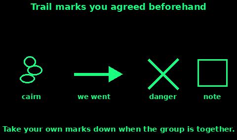

## Cairns

A cairn is a deliberate pile of stones. On a hill it can mean "the path is here". It can also send the next walker the wrong way. Build one only for your own group, and only when a note or an arrow is not enough.

1. Use loose stones. Do not pull stones out of walls, burial mounds, or a cairn that is already standing. Other people navigate by those.

2. Three stones, the top one balanced so the wind did not do it, is enough to be seen as man-made. A huge pile is a new landmark you will be blamed for.

3. Put it where your group agreed: at a junction, at the point you left the path, or at a turn you might miss in mist.

4. Keep it off plants and off the living turf if you can. A few stones on a bare spot.

5. When the group is together again, kick it down. A cairn you leave behind becomes someone else's wrong turn.

In mist, a line of small cairns is easy to lose and easy to follow into a cliff. Prefer one cairn plus an arrow and a note at the decision point. If you are the person coming behind, do not assume every pile is yours. Read the note.

## Arrows of sticks and stones

An arrow means "we went this way". Agree that, out loud, before you separate. The picture is on the trail card below.

1. Lay it on the ground, not upright, so it reads from above and from a person walking.

2. The shaft is a stick, a line of stones, or a scraped line. The head is a stone or a forked stick. Make the head obvious. A stick with no head is a stick.

3. Point the head the way you walked, not the way you came.

4. Put the time beside it, scratched in the dirt or on the note: "14:20". An arrow with no time might be yesterday's.

5. At a fork, put the arrow on the route you took, past the junction, so it cannot be read as pointing down both paths.

6. If you change your mind, destroy the old arrow. Scuff it out. Then lay the new one.

Stone arrows survive wind better than sticks. Stick arrows are easier to see in grass. Use both: stones for the head, a pale stick for the shaft, or the other way round if that contrasts.

## Blazes

A blaze is a mark on a tree or a rock: paint, a cut, or a tied cloth. Waymarked paths already use paint. Do not add blazes to those. You will rewrite someone else's route.

On a private trip:

1. Do not cut living bark. A cut is a wound, and it lasts for years after you have gone home.

2. Tie a strip of bright cloth instead, at eye height, on the side you want the next person to see. One strip means "we passed". 

3. Note the colour in your plan. "Orange wool at junctions" is a code. Random plastic is litter.

4. Take every strip down on the way back. Count them out and count them in.

5. If you must mark rock, use a small pile of stones, not paint. Paint does not come off.

In snow, a blaze on a trunk above the drift line still shows when the ground marks are buried. Cloth beats a boot print.

## Went this way, and danger

Agree this set with the group. Write it on the wallet card. Strangers will not know it, so the note should also say the meaning in words.

Went this way:

- An arrow, as above.
- Optional: your initials and the time at the tail of the arrow.

Danger, do not follow:

- A cross of two sticks, or two lines of stones, across the line you do not want followed.
- Put it on the bad route, not on the good one. An X in the middle of a path means "not this way".
- Add the word "DANGER" on the note if you can. An X alone can be missed.

This way is blocked, we turned back:

- Scuff out your outward arrow.
- Lay a new arrow back the way you came, with a note: "turned back at 15:00, all four, going to the car".

Do not use three stones in a row to mean "danger" unless your group has agreed it. Three of anything is also a distress signal. Keep distress marks (three fires, three piles built as a call for help) off the trail code, or you will call for rescue by trying to mark a path.

If the danger is a real hazard for other walkers, a cliff cornice, a broken bridge, tell mountain rescue or the landowner when you are out. A stick cross helps your group. It does not replace a proper warning.

## Leaving a note

Mountain Rescue England and Wales asks you to leave a route plan before you set out: start, finish, time due back, and a contact. Do that at home as well as on the hill. A note on the hill is for the people coming behind you, and for a rescuer who finds the spot empty.

Write in pencil or pen on paper, in a bag so the rain does not take it. Put it under a stone at the cairn, in a bothy book, or under a wiper. Say:

1. Who. Names, how many, and a phone number.

2. When. Date and time you wrote it. "Left here 20 Oct, 15:40".

3. Where you are going. The next point in plain words, and the direction. "North along the ridge to the col, then down the west path".

4. Condition. "All walking" or "one twisted ankle, moving slowly" or "staying here, need help".

5. When you will arrive or check in. "Expect the car park by 19:00".

6. Radio. Channel and tone if you are carrying PMR446. "Listening on channel 4, tone 8, at 18:00".

7. If plans change, cross the old note out with a single line, write "CANCELLED", and leave a new one. Do not destroy the old one until the new one is in place. A blank stone is not a message.

A note that says "gone for help" with no direction is how people search the wrong valley. Spend the extra minute.

If you are the searcher and you find a note, read it, write your own name and the time on the back, and leave it. Then follow, or call 999 with what it says.
