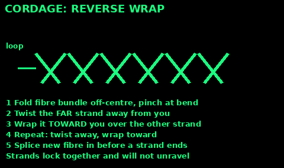
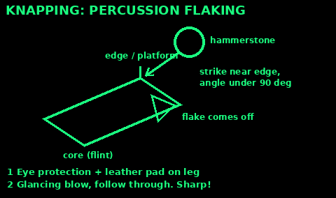
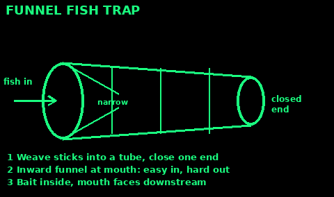
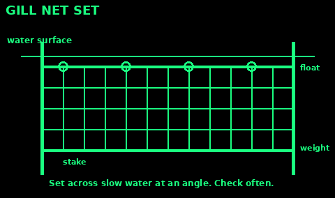
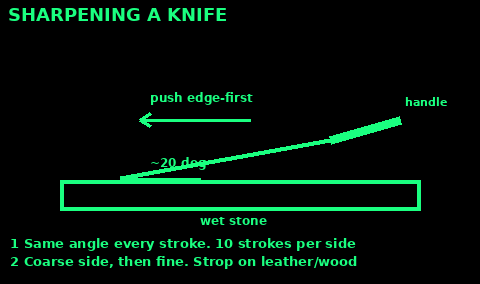

## Cordage from plants

Good fibres: nettle stems, inner bark of lime or willow, dead dogbane, long grasses, cattail leaves.

1. Nettles: wear gloves, strip leaves, crush the stem flat, peel out the stringy outer fibres. Dry them.

2. Bark: peel strips from a dead or fallen branch. The soft inner layer is the fibre.

3. Test: tie an overhand knot and pull. If it snaps, try another plant.

4. Make it into two-ply cord with a reverse wrap (next card).

Damp fibre twists better. Thin cord is stronger than you think when doubled.

## Reverse-wrap cord

1. Take a bundle of fibre. Fold it off-centre so one end is longer. This staggers the joins.

2. Pinch the fold.

3. Twist the far strand away from you.

4. Fold it toward you over the near strand. It becomes the near strand.

5. Repeat: twist away, wrap toward.

6. Before a strand runs out, lay a new piece along it and keep twisting.

7. Tie the end off.

Three cords plaited together make a rope.

## Stone knapping safety

Breaking stone makes razor edges and flying chips.

1. Protect your eyes. Glasses or goggles. Chips can blind.

2. Thick leather or canvas pad on your thigh.

3. Gloves or a leather hand pad on the hand that holds the stone.

4. Work outside, sitting, not over bare feet.

5. Keep others away, especially children.

6. Do not use stones from fires or wet stones; they can shatter.

7. Clear up flakes and bury them. They cut feet and paws.

Good stone breaks like glass: flint, chert, obsidian, quartzite. Dull rocks that crumble will not work.

## Knapping a flake knife

1. Hammerstone: a round, hard river cobble, fist-sized.

2. Find an edge on your core with an angle under 90 degrees.

3. Hold the core on your padded thigh.

4. Strike just in from the edge with a glancing blow. Follow through.

5. A flake pops off the underside. Its edge is your knife.

6. Blunt the back of the flake by rubbing it on a rough stone so you can hold it.

A plain sharp flake cuts meat, cord and hide well. It chips easily, so make several.

## Hand axe and chopper

1. Pick a fist-sized flint or tough cobble.

2. Strike flakes off one edge, turn it over, strike off the other side.

3. Work along the edge to make a wavy, sharp line.

4. Keep the butt end round and smooth for your palm.

5. Use it for chopping branches, splitting bone, scraping.

Hafted version: split a stick, wedge the stone in, wrap tight with wet rawhide or cord.

Protect your hand: wrap the butt in cloth. Strike away from your body and legs.

## Digging stick

The simplest tool. Digs roots, holes, latrines and shelter trenches.

1. Pick a straight hardwood stick, wrist-thick, about hip high.

2. Cut or rub one end into a flat chisel shape.

3. Harden it: hold the tip near hot coals, turning, until it browns. Do not burn it black.

4. Scrape off charred bits. Resharpen when blunt.

Use: stab, lever back, scoop. A flat stone tied on makes a spade.

## Fire-hardened spear

For fishing and small game, and to keep an animal at a distance.

1. Straight sapling, as tall as you, thumb- to wrist-thick.

2. Shave one end to a long point.

3. Hold the point near hot coals, turning, until the wood dries and goes light brown.

4. Scrape and sharpen again.

Fish spear: split the end into 3 or 4 prongs, wedge them apart with small sticks, sharpen each.

Spear fish in shallow water: aim below where the fish appears. Water bends light.

## Fish hooks from wood and bone

Gorge hook (easiest):

1. A sliver of bone or hard wood, 2 to 3 cm, sharp at both ends.

2. Tie the line around the middle.

3. Push it lengthwise into bait.

4. The fish swallows it, the line pulls it sideways, it lodges.

Thorn hook: hawthorn or blackthorn thorn on a twig, tie the line.

Carved hook: cut a J shape from bone or hard wood. Notch the top for the line.

Bait: worms, insects, guts. Fish early morning and dusk, in shade and deep slow water.

## Fish trap

Fish swim in easily and struggle to find the way out.

1. Weave thin flexible sticks into a tube or cone. Tie with cord.

2. Close one end.

3. Make a funnel that points inward at the open end. The narrow gap lets fish in.

4. Bait it.

5. Sink it in a stream with the mouth facing downstream, weighted with stones.

6. Check it twice a day.

Stone weir: pile rocks into a V in a shallow stream, gap at the point leading into a pool or trap.

## Gill net basics

A net that catches fish by the gills as they swim through.

1. Tie a top line between two trees or stakes.

2. Hang strands from it, about 3 to 5 cm apart. Tie across with knots to make square meshes.

3. Floats on top (wood), stones on the bottom line.

4. Set it across slow water at an angle to the current.

5. Check often so fish do not rot or get eaten.

England: fishing with any net needs Environment Agency permission (a net licence or authorisation). A rod licence does not cover nets. Survival use only.

## Snares: the law first

UK law: self-locking snares are illegal everywhere. Snares are banned in Wales and Scotland. Traps for deer, birds and protected animals are illegal. Use only in a real survival emergency, and never where people or pets walk.

Simple snare idea (survival only):

1. Make a loop of cord or wire about fist-size for rabbits.

2. Set it over a trail where it narrows, a hand above the ground.

3. Tie the end to a firm stake.

4. Set several. Check every morning and evening. Leaving animals suffering is cruel and illegal.

## Deadfall: figure-four

Survival emergencies only. Same laws as snares.

1. Three sticks: upright, diagonal, bait stick. Carve notches so they lock in a figure 4.

2. Lean a heavy flat rock or log on the diagonal.

3. Bait on the bait stick, under the rock.

4. The animal tugs the bait, the sticks collapse, the weight falls.

Set it so the rock cannot fall on your hand: hold the weight while you set the trigger. Practise with a light weight first.

## Sharpen a knife

1. Wet a whetstone, or use a smooth flat river stone.

2. Hold the blade at about 20 degrees: a matchbook height under the spine.

3. Push edge-first across the stone, as if slicing a thin layer off. Sweep heel to tip.

4. 10 strokes one side, 10 the other. Same angle every time.

5. Feel for a small burr along the edge. Then move to a finer stone.

6. Strop: pull spine-first along leather, a belt or smooth wood.

Test on paper. Cut away from your body.

## Bears

Avoid: make noise on trails, store food away from camp, never approach cubs.

Encounter: stay calm, do not run, talk in a low voice, make yourself big, back away slowly sideways. Pick up small children. Keep your pack on. Do not climb a tree: both kinds climb.

Black bear attacks: fight back hard. Aim for the face and nose.

Brown or grizzly bear attacks: play dead. Lie on your stomach, hands behind your neck, legs spread. Stay still until it leaves.

Any bear attacks you in your tent, stalks you first, or keeps going after you play dead: it sees you as food. Fight back with anything.

Bear spray works best: spray when it is close.

## Wolves and dogs

Wolves rarely attack people. Dogs bite far more often.

1. Do not run. Running triggers a chase.

2. Stand tall, face the animal, do not stare into its eyes.

3. Back away slowly.

4. Wolves: shout, wave arms, throw stones if they come close. Group together.

5. A dog attacks: put a bag, jacket or stick between you and its mouth.

6. If knocked down: curl into a ball, protect face and neck with arms.

Clean any bite well. Rabies risk: get help (see First aid).

## Snakes

The UK has one venomous snake, the adder. Bites are rare.

1. Watch where you step and put your hands. Wear boots.

2. Step around snakes. Never pick one up or kill one; most bites happen then.

3. Give a snake 2 metres and it will leave.

4. Check bedding and boots in warm areas.

Bitten: keep calm and still, keep the limb at heart level, remove rings and watches. No cutting, sucking or tourniquet. Get help. See First aid: bites.

## Wild boar

Most dangerous when cornered, with young, or wounded.

1. Back away calmly. Do not get between a sow and piglets.

2. Make noise on trails in boar areas.

3. If one charges: climb a tree or rock, even 1 metre high helps. Boar cannot climb.

4. Or step aside at the last moment; they often run straight past.

5. If knocked down: get up fast. Protect your legs and belly.

Keep dogs on leads. Boar fight dogs.

## Cows, bulls and horses

Cows with calves kill people walking dogs every year.

1. Walk calmly round the edge of the field. Do not get between cows and calves.

2. Close gates behind you.

3. If cattle come at you with a dog: let the dog go. The cattle will follow the dog, and the dog can outrun them. Walk on to the exit.

4. Do not run unless needed. Keep walking steadily to the nearest exit.

5. Avoid fields with a bull.

Horses: speak as you approach, never walk close behind them.

## Sources

Written in our own words from:

US Army FM 21-76 / ATP 3-50.21 Survival (public domain, armypubs.army.mil): cordage, tools, fishing, traps, weapons for food.

US National Park Service: nps.gov/subjects/bears/safety.htm

UK Government (gov.uk) and Defra guidance on traps and snares; Scottish and Welsh snare bans.

NHS: adder bites and animal bites.

Environment Agency: gov.uk/fishing-licences and gov.uk/guidance/apply-to-use-fishing-instruments-other-than-rod-and-line-in-england

Countryside Code: gov.uk/government/publications/the-countryside-code. Ramblers: ramblers.org.uk (cattle advice).
