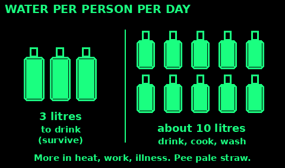
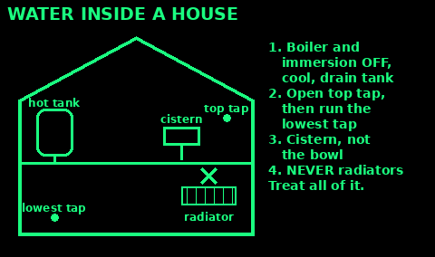

## Find it and carry it

Moving water that is clear, cold, and coming from upstream of camps and carcasses is a better place to start than a stagnant pool. It is still not safe to drink until you treat it.

Rain, snow, and dew are cleaner sources if you can catch them on a clean sheet or in a container. Do not eat snow for your water ration if you are already cold. Melt it first. Eating snow drops your temperature.

Morning dew can be wiped from grass with a cloth and wrung into a cup. It is slow. It is still water.

Carry water when you leave a known source. Drink before you start. A long walk between sources is how people get confused, and confusion is an early sign you will want to look up under dehydration in Medicine.

Do not drink seawater, urine, or blood. They make you more short of water, not less. Do not drink from a pool with a chemical sheen, a dead animal in it, or a smell of fuel.

## How much you need

Use: planning how much water to carry, find or store.

1. Drinking, to survive: at least 2.5 to 3 litres a person a day (WHO). More in heat, hard work, illness or breastfeeding.

2. Drinking, cooking and basic washing: about 10 litres a person a day.

3. Extra for babies' formula, medical devices and pets.

4. Ration sweat, not water. Work in the cool of the day, rest in shade, and keep covered.

5. Drink small amounts often. Do not save your water and collapse with a full bottle.

Signs you need more: dark yellow, strong-smelling pee, or peeing less than 4 times a day; thirst, headache, dizziness, tiredness, dry mouth. Babies: fewer wet nappies, a sunken soft spot. See Medicine for dehydration.

Mistakes: waiting until thirsty; drinking alcohol; eating salty food with little water.

Check: your pee is pale straw colour.

## Signs water is unsafe

Use: before you collect or drink any water. Clear water can still make you ill, so treat it anyway, but some water you should not use at all.

Do not use, even boiled:
1. A smell of fuel, chemicals or solvent, or an oily rainbow sheen.
2. Blue-green algae: green or blue scum, paint-like or pea-soup water, often in warm still lakes. Its toxins are not killed by boiling.
3. Orange, red or white staining from old mines, or near factories and tips.
4. Floodwater. It carries sewage and chemicals.

Treat with great care, only if there is nothing else:
5. Dead animals in or near it, upstream of you.
6. Below farms, towns, sewage outfalls or roads.
7. Stagnant pools with foam, a rotten egg smell or lots of flies.

Mistakes: thinking clear and cold means clean; trusting a stream below a field of sheep.

Check: you have walked upstream and seen what is there.

## Settle, filter, boil

If the water is cloudy, let it sit until the grit drops. Pour off the clear part. Pour it through a cloth, a shirt, or a bandanna to take out the rest of the silt. This step does not remove germs. It makes the next step work, and it keeps you from drinking mud.

Boil it. Bring it to a rolling boil, bubbles that do not stop when you stir, for one minute. Above 2,000 metres (6,500 feet), boil for three minutes. Boiling is the method to trust when you can make fire.

A lid cuts the fuel you spend. Let it cool before you put it in a soft bottle you care about.

Store treated water covered. Do not dip a dirty cup into the clean pot. Pour.

If you have purification tablets or a filter you carried in, follow the instructions printed on that device. A clogged filter that you bypass is just a bottle.

When you cannot boil, and the day is sunny, use a clear plastic bottle. Fill it with the clearest water you have. Lay it on its side in full sun for at least six hours. If the sky is more than half cloud, leave it for two days. This is sunlight treatment, not boiling. Use boiling when you can.

## Boiling: the details

1. Filter cloudy water through cloth first.

2. Bring to a rolling boil: big bubbles that keep going when you stir.

3. Keep it boiling for 1 minute. Above 2,000 metres (6,500 feet), boil for 3 minutes.

4. Let it cool covered.

5. Flat taste: pour it between two clean containers a few times to add air back.

Boiling kills germs. It does not remove chemicals, fuel, metals or salt.

No pot: heat stones in the fire and drop them into water held in a bark container, wood bowl or hole lined with plastic.

## Store water safely

1. Use clean containers with lids. Food-grade plastic or glass. Never ones that held chemicals or fuel.

2. Clean containers with a little bleach in water (1 teaspoon per litre), rinse with treated water.

3. Use a container with a tap or a narrow neck. Pour; do not dip cups or hands in.

4. Keep it cool and dark.

5. Label it with the date. Re-treat or replace stored water every 6 months.

6. Keep drinking water apart from washing water.

Plan at least 3 litres per person a day for drinking. More in heat or hard work, plus water for cooking and washing. See How much you need.

Long-term store: the UK government advises buying sealed bottled water rather than filling your own bottles. Keep it to its date, then use it and replace it. Your own filled containers: tap water, clean containers, swap every 6 months.

Keep stored water away from petrol, paint, cleaning products and garden chemicals. Plastic lets their fumes through.

Check: every container has a date, and the oldest gets used first.

## Emergency water at home

Use: the taps stop, and you have no stored water yet. There is often a lot of water inside a house.

1. Turn off the water at the stopcock if the mains may be dirty (you will be told).

2. Hot water cylinder (if you have one, usually in an airing cupboard): switch off the boiler and immersion heater first. Let it cool. Drain from the tap near the bottom. Treat it before drinking.

3. Pipes: open the highest tap in the house, then run the lowest tap into a clean container.

4. Toilet cistern, the tank behind the toilet, not the bowl: usable if no blue or chemical cleaner is in it. Treat before drinking.

5. Ice cubes, and the liquid in tinned vegetables and fruit.

6. A loft cold-water tank is not drinking water: boil or treat it, or use it for washing and flushing.

7. Rain butts: flushing and washing only, unless treated.

Combi boilers have no hot water tank.

Never drink from radiators or central heating systems. They contain chemicals.

Check: every container is labelled drink (treated) or wash.

