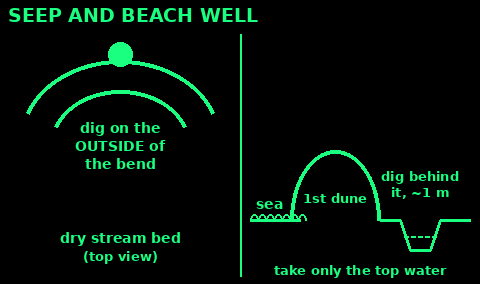
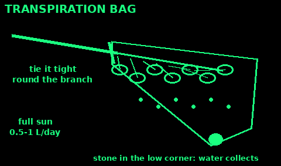
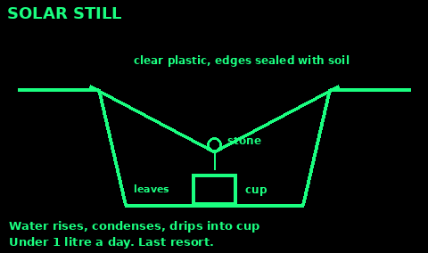
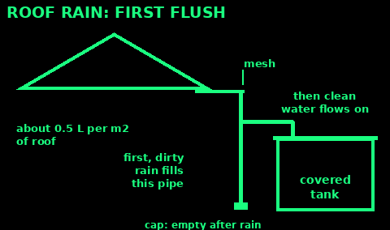

## Where to look

1. Follow valleys and low ground downhill. Water collects there.

2. Look for green plants, reeds, willows, and lines of trees in dry country.

3. Watch animals and birds at dawn and dusk. Insects and flies stay near water. Pigeons and finches fly to water.

4. Dig at the outside bend of a dry stream bed, where water last flowed. Wait for water to seep into the hole.

5. On the coast, dig a hole behind the first dune. The top layer of seeping water is the least salty.

All found water still needs treating.

## Signs from plants and animals

Use: dry country, or any time you cannot see water.

1. Plants that need water: willow, alder, reeds, rushes, bulrushes, sedges, lush bright green patches. Dig at the lowest point near them.

2. Lines of trees or bushes across open land often follow a stream or spring.

3. Birds: many seed-eating birds (pigeons, doves, finches) drink at dawn and dusk. A flock flying low and straight is often going to water.

4. Insects: bees, wasps and flies stay within reach of water. Mosquitoes and midges mean water close by.

5. Animal paths that join up and run downhill often lead to water.

6. Frogs, damp mud, and mosses on rock show water near the surface.

Mistakes: following birds of prey or sea birds (they get water from food); drinking where animals foul it.

Check: two or three signs that point to the same low spot.

## Dig a seep or beach well

Use: no running water, but the ground may be wet underneath.

Seep:
1. Pick the lowest point: the outside of a bend in a dry stream bed, the foot of a cliff or slope, or where green plants grow.
2. Dig a hole about 30 to 60 cm deep, until the soil is damp.
3. Wait. Water seeps in, slowly, often muddy.
4. Let it settle. Scoop the clear water off the top. Filter and treat it.

Beach well:
1. Go behind the first line of sand dunes, well above the high-tide line.
2. Dig a hole about a metre deep in the lowest spot.
3. Fresh water floats on top of salt water. Take only the top layer, gently.
4. Taste a drop: if it is salty, dig further from the sea.

Mistakes: digging hard in the midday heat (you sweat more than you find); stirring up the bottom.

Check: water rising slowly in the hole after 10 to 30 minutes.

## Water from plants

Use: tropical vines, bamboo and some trees hold drinkable water. In Britain, birch sap in early spring.

Vines (tropics):
1. Cut a deep notch high up the vine first, then cut it through near the ground.
2. Hold the cut end over a cup. Clear water drips out.
3. Drink only if it is clear, watery, and not sticky, milky or bitter. Milky sap can be poisonous.
4. When it stops, cut another piece off the top.

Bamboo: shake green stems and listen for sloshing. Cut a notch at the bottom of a section and pour it out. Treat it.

Birch sap (Britain, about late February to April, before the leaves open):
1. Drill or cut a small hole 2 to 3 cm into the trunk of a large birch, at waist height, slanting up.
2. Push in a clean tube or a twig and let it drip into a bottle.
3. Take a few litres at most, then plug the hole tightly with a wooden peg.
4. Use it within a day or two, or boil it.

Ask the landowner before tapping trees. Do not tap young trees.

Check: the liquid is clear and tastes of water, not bitter.

## Transpiration bag

Use: sunny days, leafy trees or bushes, and a clear plastic bag. The best still: often 0.5 to 1 litre a day.

1. Pick a healthy, leafy branch of a tree or shrub that is not poisonous (not yew, laburnum, rhododendron, oleander or anything with milky sap).

2. Put a small stone in one corner of a clear bag. Slide the bag over the branch.

3. Tie the mouth tight round the branch so the stone corner hangs lowest.

4. Leave it in full sun. Water collects in the low corner.

5. Drain it through a small hole you can tie shut, or a tube. Move the bag to a new branch every day or two.

Mistakes: a poisonous plant; a coloured or torn bag; a branch in the shade.

Check: drops on the inside of the bag within an hour or two.

## Solar still

Slow. Gives a little water, often under a litre a day. Only use it when nothing else works.

1. Dig a hole about 1 metre wide and 60 cm deep in damp ground, in full sun.

2. Put a cup in the centre bottom.

3. Pile green leaves or put salty or dirty water around the cup. Not in the cup.

4. Cover the hole with clear plastic. Seal the edges with soil.

5. Put a small stone in the middle of the plastic so it dips over the cup.

6. Water evaporates, condenses on the plastic, and drips into the cup.

The water from the cup is distilled and safe to drink. A tube from the cup lets you drink without opening it. Do not dig hard in heat: you lose more sweat than you gain.

## Catch rain, dew and snow

1. Rain: spread a tarp, plastic sheet or poncho in a slope into a container. Let the first minutes of rain rinse it, then collect.

2. Run a cloth from a tree trunk down into a bottle. Rain running down the bark follows it.

3. Dew: tie cloth round your ankles and walk through wet grass before sunrise. Wring it out.

4. Snow and ice: melt in a pot with a little water already in it so it does not scorch. Ice gives more water than snow.

Rainwater from a clean sheet is fairly safe. Treat it if you can. Water off roofs needs treating.

## Snow and ice: melt it

Use: winter and mountains. Do not eat snow when you are cold.

1. Melt it. Eating snow cools you down, costs body heat and can hurt your mouth.

2. Put a little water in the pot first, then add snow a bit at a time. Dry snow in a dry pot can scorch.

3. Ice gives much more water than snow for the same fuel. Old, dense snow beats fresh powder.

4. No fire: put snow in a bottle inside your coat, not against bare skin.

5. Use clean white snow. Not yellow, pink, or by roads and paths.

6. Treat it if you can. Snow carries germs from animals and people.

Mistakes: a pot full of powder on a fierce flame; eating handfuls on the move while cold.

Check: a pot of meltwater, not a burnt smell.

## Rain from roofs: first flush

Use: collecting a lot of rain from a house, shed or tarp roof.

1. Clean gutters. A fine mesh over the downpipe stops leaves.

2. Throw away the first flush: the first rain off a roof carries dust, bird droppings and moss. A common rule is about the first 0.5 litre for each square metre of roof (more for a dirty roof).

3. A simple diverter: a capped pipe that fills first, before water can pass to the tank. Empty it after each rain.

4. Cover the tank. Keep out light, leaves, insects and animals.

5. Do not collect from roofs with old asbestos sheets, fresh tar or treated wood.

6. Treat it before drinking: boil, chlorinate or filter. Untreated, use it for washing and flushing.

Mistakes: an open tank (mosquitoes, algae); drinking it untreated.

Check: the tank water is clear and smells of nothing.

## Seawater: never drink it

Use: on the coast or at sea. Read this before you are thirsty.

1. Never drink seawater, not even mixed with fresh. It is far saltier than your body. It dehydrates you faster and can kill.

2. Never drink urine. Never drink blood.

3. Get fresh water out of seawater by distilling it: boil it and catch the steam. See Distil with a pot in Making it safe.

4. A solar still with seawater in the bottom also works (see Solar still).

5. Rain and dew at sea: catch them on any sheet.

6. Fish flesh holds some water. Eat little protein if water is short: it needs water to digest.

Check: nothing salty goes in your mouth.
