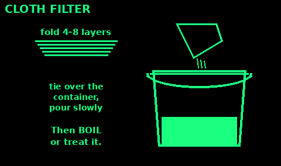
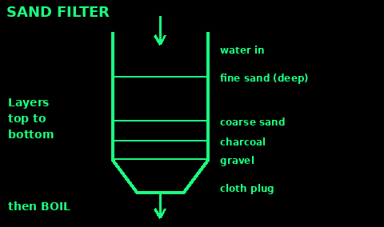
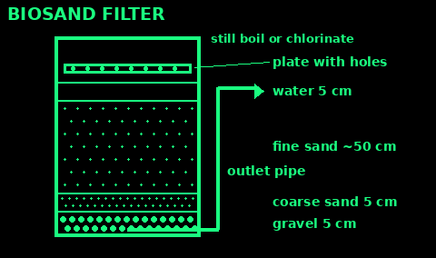
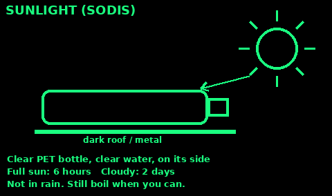
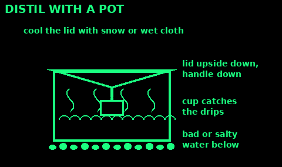

## Which method?

Use: choosing how to treat the water you have.

1. Cloudy? Settle it, then pour it through cloth or a sand filter first. Every method works better on clear water.

2. Boiling kills all germs. Use it whenever you have fuel.

3. A filter you carried (ceramic, hollow-fibre straw or pump) removes bacteria and parasites. Most do not stop viruses.

4. Chemicals (chlorine bleach, tablets, iodine) kill bacteria and viruses. Some parasites (Cryptosporidium) survive chlorine and iodine.

5. Sun (SODIS) and UV pens work in clear water.

6. Distilling removes salt, metals and most chemicals, and germs.

Best: filter, then boil or chlorinate.

What does not work: charcoal alone, cloth alone, or sand alone kill nothing. Nothing except distilling takes out fuel, chemicals or salt.

Check: you have done a clearing step and a killing step.

## Cloth filter

Use: the first step for any cloudy or gritty water.

1. Take a clean, tightly woven cotton cloth: an old sari, a shirt, a tea towel or a bandana.

2. Fold it to give 4 to 8 layers.

3. Tie or hold it over the mouth of a clean container.

4. Pour slowly through it.

5. Use the same side up every time. Wash and dry it in the sun after use.

Folded cloth takes out silt and many larger germs riding on it. It does not make water safe. Boil or treat it after.

Mistakes: a single thin layer; flipping the cloth over (the dirty side then faces the clean water).

Check: the water comes out clearer than it went in.

## Sand filter

This makes water clearer and removes some germs. Still boil or treat after.

1. Cut the bottom off a plastic bottle, or use a cloth tied into a cone. Turn it upside down.

2. Put a cloth or grass plug in the neck.

3. Layer from the bottom: small gravel, then coarse sand, then fine sand. Make the fine sand the deepest layer.

4. Crushed charcoal from your fire, not ash, can go under the sand to improve taste and smell.

5. Pour water in slowly. Throw away the first lot.

6. Rinse or replace the top layer of sand when it slows down.

## Biosand filter

Use: a home filter for daily water over months. It takes about 2 to 4 weeks to start working well. Keep disinfecting the water after it.

1. A tall container, about 90 cm, plastic or concrete. An outlet pipe from the bottom that rises up the outside to just above the sand top, so the sand always stays under water.

2. Bottom: about 5 cm of washed small gravel round the pipe inlet.

3. Then 5 cm of washed coarse sand or fine gravel.

4. Then about 50 cm of washed fine sand.

5. Water stands about 5 cm above the sand when it stops flowing. A slimy living layer grows in the top of the sand and eats germs.

6. A plate with small holes sits above the sand, so poured water does not dig into it.

7. Pour in a bucket a day. Leave at least an hour between pourings, never more than two days.

Mistakes: letting it dry out; stirring the top sand; drinking it in the first weeks without treatment.

Check: clear water, a steady slow flow, and you still boil or chlorinate it.

## Charcoal filter

Use: improve taste, smell and colour after you have made water safe, or before.

1. Use charcoal from your own fire: hardwood, fully black, not ash. Not barbecue briquettes, which contain other things.

2. Crush it to the size of rice. Rinse it until the water runs clear.

3. Pack it in a layer at least 10 cm deep, between cloth or sand layers, in a bottle with the bottom cut off.

4. Pour water through slowly.

5. Replace the charcoal every week or two. It traps germs and they grow in it.

Charcoal does not kill germs. Boil or treat as well.

Mistakes: using ash; never changing it.

Check: the water tastes of nothing.

## Ceramic and straw filters

Use: bought filters: ceramic candles, pumps, squeeze bags and drinking straws (hollow fibre).

1. They strain out bacteria and parasites, if the pores are 1 micron or smaller (most are 0.1 to 0.2). Most do not stop viruses.

2. Pre-filter cloudy water through cloth. Silt clogs them fast.

3. Follow the maker's cleaning: back-flush hollow fibre filters with clean water, scrub ceramic candles gently.

4. Do not let a used hollow fibre filter freeze. Ice cracks the fibres and it stops working, with no sign. Keep it in your sleeping bag in frost.

5. Keep the clean side clean: do not dip the outlet in dirty water.

6. Where sewage or many people may be upstream (viruses), boil or chlorinate too.

Mistakes: dropped or frozen filters; ignoring the filter's life limit.

Check: you know the date and the litres the filter has done.

## Bleach and tablets

Use plain, unscented household bleach with no added cleaners. Check the strength on the label.

1. Filter cloudy water first.

2. Bleach 5 to 6%: 2 drops per litre, or 8 drops per gallon (3.8 litres).

3. Bleach 8.25%: 2 drops per litre, or 6 drops per gallon.

4. Bleach 1% (some thin bleaches): 10 drops per litre.

5. Cloudy, coloured or very cold water: double the dose.

6. Stir and wait 30 minutes.

7. It should smell faintly of chlorine. No smell: add the same dose again and wait 15 more minutes.

Tablets (chlorine dioxide, iodine): follow the packet exactly, including the wait time. Iodine is not for pregnant women or people with thyroid problems. Chemicals work poorly on some parasites; boiling is better.

## Iodine

Use: chemical treatment when you have no bleach or tablets. Short-term only.

1. Filter cloudy water first.

2. 2% tincture of iodine: 5 drops per litre of clear water. 10 drops if cloudy or coloured.

3. Stir. Wait at least 30 minutes. Cold water: wait longer, several hours if very cold.

4. Iodine tablets: follow the packet.

Not for: pregnant women, people with thyroid problems or iodine allergy, or anyone for more than a few weeks at a time.

It does not kill Cryptosporidium. Boil or filter as well if you can.

Mistakes: not waiting; using it for months.

Check: a faint yellow-brown colour, and you waited the full time.

## UV pens

Use: a battery UV light that kills germs in clear water.

1. Clear water only: filter first. Cloudy water shields the germs.

2. Use a clear, wide-mouthed bottle, usually 0.5 or 1 litre.

3. Put the lamp in, switch on, and stir for the full time the maker says (often about 1.5 minutes per litre).

4. Make sure the lamp is covered by water.

5. Wipe the threads of the bottle with treated water.

No chlorine is left in the water, so it can be dirtied again. Drink it soon.

Mistakes: flat batteries; cloudy water; not stirring.

Check: the light shows the full cycle finished.

## Sunlight (SODIS)

Works on germs in clear water, if you have sun and clear bottles.

1. Use a clean, clear, colourless PET bottle, 3 litres or less, not badly scratched. Take the label off.

2. Filter the water until it is clear. If you can read big print through a full bottle, it is clear enough.

3. Fill it to the top and cap it.

4. Lay it on its side in full sun, on a dark roof or metal sheet if you have one.

5. 6 hours if less than half the sky is cloudy. Two days in a row if more than half is cloudy.

6. Drink straight from the bottle.

Does not work well in long spells of rain (collect rainwater instead), on cloudy water, or in coloured bottles.

## Distil with a pot

Use: salty, dirty or chemically doubtful water. It removes salt and most chemicals as well as germs. It uses a lot of fuel.

1. Fill a big pot a third full with the bad water.

2. Lid method: turn the lid upside down so its handle points down, toward a cup floating or standing in the middle of the pot. Steam condenses on the lid, runs to the handle and drips into the cup.

3. Tube method: fit a tube or pipe to the lid, run it down through cold water or wet cloth into a clean container.

4. Cloth method: hold a clean cloth in the steam, wring it into a cup.

5. Keep a low boil. Do not let it boil dry.

6. Cool the lid with snow, cold water or wet cloth to make more drip.

Fuel, solvent and some chemicals boil off with the steam. Do not distil water that smells of fuel.

Mistakes: boiling over into the cup; a cup that tips.

Check: the water in the cup is not salty.

## Clean your containers

Use: before storing treated water, and every few weeks.

1. Wash with soap and water. Rinse.

2. Sanitise: add 1 teaspoon (5 ml) of plain unscented 5% bleach to 1 litre of water.

3. Put it in the container, close it and shake so it wets every inside surface.

4. Leave it at least 30 seconds, then pour it out.

5. Let it air dry, or rinse with treated water.

6. Clean taps, lids and the threads too.

Use food-grade containers only. Never ones that held chemicals, fuel or paint.

Check: no slime inside, and it smells clean.
