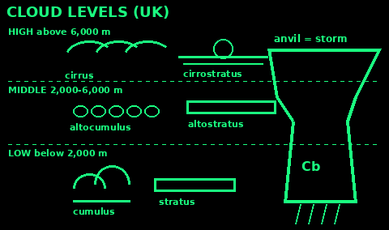
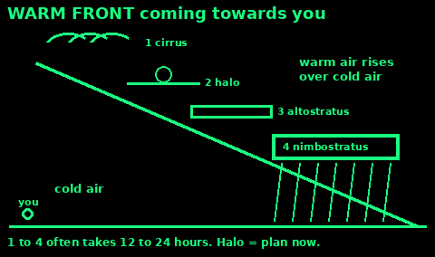
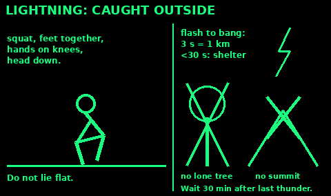

## Read the sky

Most UK weather comes in from the Atlantic, from the west. Look west for what is coming.

Signs of worse weather on the way:
- High wispy cirrus (mares' tails) spreading across the sky from the west.
- A milky veil with a ring (halo) round the sun or moon.
- Cloud getting thicker and lower over hours.
- Wind backing (turning anticlockwise, for example from west to south) and strengthening.
- Pressure falling.
- Pine cones closing up in damp air.

Signs of settling weather:
- Pressure rising.
- Cloud breaking and lifting.
- Red sky at sunset, when weather comes from the west.
- Light winds, clear nights, dew or frost in the morning.

Towering cumulus that grows by the hour on a warm afternoon can become a thunderstorm before evening.

## Clouds

Clouds have three levels. Over the British Isles:

Low (base below about 2,000 m): stratus (grey sheet, drizzle, hill fog), stratocumulus (lumpy grey layer), cumulus (fair-weather puffs), cumulonimbus (thunderstorm).

Middle (about 2,000 to 6,000 m): altocumulus (small rolls or patches, mackerel sky), altostratus (grey veil, sun like through frosted glass), nimbostratus (thick, dark, steady rain).

High (above about 6,000 m): cirrus (wisps), cirrostratus (thin veil, halo), cirrocumulus (tiny ripples).

Names: cirro means high and wispy, alto middle, strato a flat layer, cumulo heaped, nimbo rain-bearing.

The cloud to fear is cumulonimbus: a huge tower, dark underneath, often with a flat spreading anvil at the top. It brings downpours, hail, gusts and lightning.

## Fronts

A front is where warm and cold air meet. Most cross the UK from west to east.

Warm front, in order as it arrives:
1. Cirrus wisps, high up.
2. Cirrostratus veil and a halo round the sun.
3. Altostratus: the sun goes watery, then disappears.
4. Nimbostratus: low dark cloud, steady rain or drizzle for hours.
5. After it passes: milder, muggy, often still cloudy.

That sequence can take 12 to 24 hours. When the halo appears, plan shelter and water.

Cold front: a line of dark cloud, a sudden heavy band of rain, sometimes thunder, gusty winds, a sharp drop in temperature and a wind shift (often to the north-west). It passes quickly. After it: cooler, clearer, with showers.

An occluded front is a mix of both. Expect rain either way.

## Pressure and wind

High pressure usually brings settled weather: light winds, dry days, and in winter, cold clear nights with frost and fog.

Low pressure usually brings unsettled weather: cloud, rain and wind. The faster pressure falls, the stronger the wind will be.

A barometer, or the pressure setting on a watch or phone, read every 3 hours, gives warning. A steady fall means a low is coming. A fast fall means a gale is likely. A rise after rain means it is clearing.

In the northern hemisphere, stand with your back to the wind. Low pressure is on your left, high on your right. Winds blow anticlockwise round a low and clockwise round a high. In the southern hemisphere it is the other way round.

So in Britain, if the wind is from the south or south-west and strengthening, the low is to the west or north-west: rain is coming. A wind swinging round to the north-west after rain usually means the front has passed.

## Weather sayings

Some old sayings have truth in them. Many do not.

Mostly true in the UK:
- Red sky at night, shepherd's delight. A red sunset means clear air to the west, where the weather comes from.
- Red sky in the morning, shepherd's warning. The clear air has moved east and wet weather may follow.
- A ring round the sun or moon, rain will come soon. Ice-crystal cloud is moving in ahead of a front.
- Mackerel sky and mares' tails make tall ships carry low sails. Altocumulus and cirrus can come before a storm.
- Pine cones open in dry air and close in damp air.
- Wind from the east in winter is bitter. It brings air from frozen Europe.

Not reliable:
- Cows lying down before rain.
- Rain before seven, fine by eleven.
- What happens on St Swithun's Day (15 July) does not last 40 days.

Use sayings as clues, not as forecasts.

## Thunder and lightning

If you can hear thunder, you are close enough to be struck. Lightning can strike up to about 15 km (10 miles) from the storm.

Count from flash to bang. About 3 seconds is 1 km. Under 30 seconds (10 km), get to shelter now.

Best shelter: a solid building, or a hard-topped car with the windows up. Tents, open shelters, sheds, cave mouths and trees do not protect you.

Caught in the open:
1. Get off hilltops, ridges and summits. Go down.
2. Get away from water, lone trees, poles, pylons, wire fences and rails.
3. Put down metal: walking poles, umbrellas, fishing rods, bikes.
4. Spread a group out, at least several metres apart, so one strike does not hit everyone.
5. If you feel your hair stand on end or hear buzzing, squat low on the balls of your feet, hands on knees, head tucked in. Touch the ground as little as you can. Do not lie flat.

Wait 30 minutes after the last thunder before going out again.

A person struck by lightning does not hold a charge. It is safe to touch them. Check breathing and start CPR if needed. See First aid.

## Floods

Driving into flood water is the leading cause of death in UK floods. Walking into it kills too.

1. Do not walk, swim, cycle or drive through flood water. About 15 cm of water that does not look dangerous can knock a person over. 30 cm of moving water can float a car. About 60 cm can carry away any vehicle.

2. Flood water hides open manholes, washed-out roads and debris, and often carries sewage.

3. Move people, pets, medicines, water and food upstairs or to higher ground before the water comes.

4. Turn off gas, electricity and water if it is safe. Never touch a switch while standing in water.

5. Stay away from river banks, fords, culverts, and bridges with water near the top.

6. Do not camp in valley bottoms, dry gullies or on river gravel. Rain far upstream can arrive as a wall of water.

After a flood: treat everything the water touched as dirty. Wash hands after cleaning up. Throw away food that got wet. Boil or treat water until the supply is declared safe.

In England the warnings are: Flood alert (flooding is possible, prepare now), Flood warning (flooding is expected, act now: move to higher ground or upstairs), Severe flood warning (danger to life: be ready to evacuate). Floodline: 0345 988 1188. In danger, call 999.

Tents, caravans and bungalows are the worst places to be in a flash flood. Heavy thunder rain over steep valleys can flood a stream in minutes, with no warning.

## Heatwave

In the UK a heatwave is at least three days in a row at or above a local threshold: 25°C in much of the north and west, up to 28°C in London. People get ill and die in heat that would feel normal elsewhere, because homes and bodies are not used to it.

Most at risk: over-65s, babies and young children, people with heart, lung or kidney disease, people living alone, and people working outdoors.

1. Keep out of the sun from 11am to 3pm. Work early and late.

2. Drink more, before you feel thirsty. Avoid alcohol. Eat cold food.

3. Close curtains and windows on the sunny side during the day. Open them at night when it is cooler outside.

4. Cool the skin with water and a breeze. A fan helps below about 35°C.

5. Check on old and ill neighbours every day.

6. Never leave a child or animal in a car.

Heat exhaustion (headache, dizziness, sweating, cramps, thirst): cool place, loosen clothes, fluids, cool the skin. Should improve in 30 minutes. If not, or if the person is confused, has hot dry skin, or has a fit, it is heatstroke. Call 999. See First aid.

Heat dries the land. Do not light fires in dry grass or heath. Watch for wildfire smoke and leave early.

## Cold snap

Cold raises the risk of heart attacks, strokes and chest infections, not just hypothermia and frostbite. Older people and small children are most at risk.

1. Heat at least one room you live and sleep in to 18°C if you can. Gather everyone in that room.

2. Wear layers, a hat and socks indoors. Use blankets and sleeping bags.

3. Eat hot meals and have warm drinks through the day.

4. Keep moving. Do not sit still for hours.

5. Check on older neighbours. Make sure they have food, medicine and heat.

6. Never use a barbecue, generator or camp stove indoors. Carbon monoxide kills without warning. Keep a window open a crack by any flame.

Outside: ice makes paths and steps deadly. Wear shoes with grip. Snow on hills means whiteout and buried paths. Frozen lakes and ponds are rarely safe in Britain. Stay off them.

Burst pipes: know where your stopcock is. Lag pipes and keep a little heat on.

## Wind and storms

Gusts are stronger than the average wind. Storm gusts of 100 km/h (60 mph) or more bring down trees, branches, roofs and power lines.

1. Stay indoors away from windows in the worst of it.

2. Tie down or bring in anything that can blow about.

3. Do not camp under trees, especially dead ones. Branches fall long after the wind has peaked.

4. Stay away from the sea front, cliffs and piers. Waves are bigger than they look and can pull people in.

5. On hills, wind is far stronger than in the valley. On ridges in a gale you can be blown off your feet. Turn back early.

6. Downed power lines can be live. Stay well away and report them (105 in the UK).

Wind chill: on exposed skin, wind makes cold feel much colder and speeds frostbite. Cover face and hands.

## UK weather and warnings

The UK's weather is changeable because it sits between the Atlantic and Europe. Rain often comes from the west. Western hills and mountains get the most. The east is drier.

Hills make their own weather: colder (roughly 1°C less for every 150 m up), windier, and often in cloud when the valley is clear. Hill fog can come down in minutes.

Fog: radiation fog forms in valleys on clear, calm nights, mostly in autumn and winter, and usually clears after sunrise. Sea fog (haar) rolls in on the east coast in spring and summer.

Met Office warnings use colours. Each one mixes how bad the impact could be with how likely it is, so read the text:
- Yellow: some disruption likely, or a small chance of something worse. Check if it affects you.
- Amber: impacts more likely. Possible risk to life and property. Think about changing your plans.
- Red: dangerous weather expected. Risk to life. Act now, avoid travel, follow the emergency services.

Warnings cover rain, thunderstorms, wind, snow, lightning, ice, extreme heat and fog. Listen to BBC local radio or Radio 4 on batteries if the internet is down. See Signals & Radio.

## Weather sources

Written in our own words from public guidance:

Met Office: weather.metoffice.gov.uk/learn-about/weather/types-of-weather/clouds, weather.metoffice.gov.uk/learn-about/weather/atmosphere/weather-fronts, weather.metoffice.gov.uk/learn-about/weather/how-weather-works/high-and-low-pressure/wind-flow, weather.metoffice.gov.uk/learn-about/weather/how-weather-works/red-sky-at-night, weather.metoffice.gov.uk/warnings-and-advice/seasonal-advice/health-wellbeing/stay-safe-in-thunder-and-lightning, weather.metoffice.gov.uk/learn-about/weather/types-of-weather/temperature/heatwave, weather.metoffice.gov.uk/learn-about/weather/types-of-weather/fog, weather.metoffice.gov.uk/guides/warnings

US National Weather Service, thunder distance: weather.gov/safety/lightning-science-thunder. CDC lightning questions (safe shelter, touching a person who was struck): cdc.gov/lightning/faq/index.html

GOV.UK and Environment Agency floods: gov.uk/help-during-flood, gov.uk/guidance/flood-alerts-and-warnings-what-they-are-and-what-to-do, gov.uk/guidance/flash-flooding and gov.uk/government/news/driving-complacency-74-of-drivers-would-risk-life-in-flood-water

NHS: nhs.uk/live-well/seasonal-health/heatwave-how-to-cope-in-hot-weather, nhs.uk/live-well/seasonal-health/keep-warm-keep-well, nhs.uk/conditions/hypothermia

A forecast beats any sign in the sky. Get one when you can.
